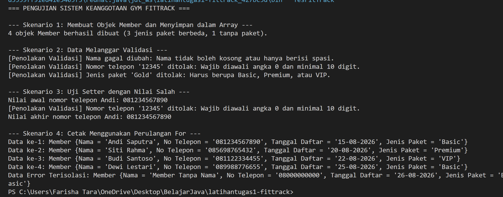
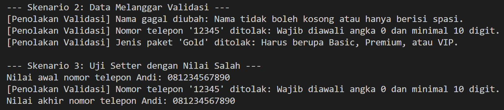

# Tugas 1: Sistem Keanggotaan Gym FitTrack

- **Nama:** Farisha Tara Ushna Dinatama
- **NPM:** 250810701100105
- **Kelas praktikum:** Kelas A Praktikum PBO

## Deskripsi Singkat

FitTrack adalah gym kecil yang masih mencatat data member di buku tulis. Program ini dibuat untuk menyimpan data member di Java. Fokusnya memastikan data yang masuk valid, terutama nomor telepon.

## Fitur Utama

- Menambah member baru (nama, nomor telepon, tanggal daftar, jenis paket).
- Menambah member tanpa memilih paket, otomatis jadi Basic.
- Menolak nama kosong atau hanya spasi.
- Menolak nomor telepon yang tidak diawali 0 atau kurang dari 10 digit.
- Menolak jenis paket selain Basic, Premium, dan VIP.
- Menampilkan pesan alasan kalau data ditolak.
- Data lama tidak berubah kalau data baru ditolak.
- Member tetap terbuat walaupun ada data yang salah, dengan nilai default.
- Menampilkan semua member dengan format yang rapi.

## Konsep OOP yang Diterapkan

| Konsep | Lokasi | Alasan |
|---|---|---|
| Class dan object | `Member`, `TesFitTrack` | `Member` mewakili satu member gym. `TesFitTrack` dipakai untuk menguji. |
| Encapsulation | Atribut `private` di `Member` | Data hanya bisa diubah lewat setter, jadi selalu dicek dulu. |
| Constructor | Constructor 4 parameter di `Member` | Mengisi data saat objek dibuat, lewat setter supaya validasi tidak ditulis dua kali. |
| Constructor overloading dan `this(...)` | Constructor 3 parameter di `Member` | Untuk member tanpa paket. Memanggil constructor lengkap dengan paket Basic. |
| Kata kunci `this` | Setter dan constructor | Membedakan atribut dengan parameter yang namanya sama. |
| Validasi di setter | `setNama`, `setNoTelepon`, `setTanggalDaftar`, `setJenisPaket` | Aturan cukup ditulis di satu tempat. |
| Konstanta (`final`) | `MIN_PANJANG_TELP`, `PAKET_*`, `DEFAULT_*` | Menghindari angka dan teks yang muncul tanpa penjelasan. |
| Override `toString()` | `Member` | Data tercetak berlabel, bukan alamat memori. |
| Array dan `for` | `TesFitTrack` | Menyimpan banyak member dalam satu array lalu mencetaknya satu per satu. |

## Struktur Project

```
tugas1-fittrack/
├── src/
│   ├── Member.java
│   └── TesFitTrack.java
├── .gitignore
└── README.md
```

## Prasyarat

- JDK 21 
- IDE: IntelliJ IDEA

## Cara Menjalankan

### Lewat IntelliJ

1. Buka folder project di IntelliJ.
2. Buka file `TesFitTrack.java`.
3. Klik tombol panah hijau di samping `main`, lalu pilih **Run**.

### Lewat Command Line

Jalankan dari folder utama project:

```bash
javac -d out src/*.java
java -cp out TesFitTrack
```

## Contoh Output

```
=== PENGUJIAN SISTEM KEANGGOTAAN GYM FITTRACK ===

--- Skenario 1: Membuat Objek Member dan Menyimpan dalam Array ---
4 objek Member berhasil dibuat (3 jenis paket berbeda, 1 tanpa paket).

--- Skenario 2: Data Melanggar Validasi ---
[Penolakan Validasi] Nama gagal diubah: Nama tidak boleh kosong atau hanya berisi spasi.
[Penolakan Validasi] Nomor telepon '12345' ditolak: Wajib diawali angka 0 dan minimal 10 digit.
[Penolakan Validasi] Jenis paket 'Gold' ditolak: Harus berupa Basic, Premium, atau VIP.

--- Skenario 3: Uji Setter dengan Nilai Salah ---
Nilai awal nomor telepon Andi: 081234567890
[Penolakan Validasi] Nomor telepon '12345' ditolak: Wajib diawali angka 0 dan minimal 10 digit.
Nilai akhir nomor telepon Andi: 081234567890

--- Skenario 4: Cetak Menggunakan Perulangan For ---
Data ke-1: Member {Nama = 'Andi Saputra', No Telepon = '081234567890', Tanggal Daftar = '15-08-2026', Jenis Paket = 'Basic'}
Data ke-2: Member {Nama = 'Siti Rahma', No Telepon = '085698765432', Tanggal Daftar = '20-08-2026', Jenis Paket = 'Premium'}
Data ke-3: Member {Nama = 'Budi Santoso', No Telepon = '081122334455', Tanggal Daftar = '22-08-2026', Jenis Paket = 'VIP'}
Data ke-4: Member {Nama = 'Dewi Lestari', No Telepon = '089988776655', Tanggal Daftar = '25-08-2026', Jenis Paket = 'Basic'}
Data Error Terisolasi: Member {Nama = 'Member Tanpa Nama', No Telepon = '08000000000', Tanggal Daftar = '26-08-2026', Jenis Paket = 'Basic'}
```

### Screenshot

Skenario normal:



Skenario validasi menolak data:



## Nilai Default

Kalau data tidak valid saat objek dibuat, atribut diisi nilai default ini:

| Atribut | Default | Alasan |
|---|---|---|
| `nama` | `Member Tanpa Nama` | Jelas terlihat bahwa nama belum diisi. |
| `noTelepon` | `08000000000` | Lolos validasi dan mudah dikenali sebagai nomor palsu. |
| `tanggalDaftar` | `01-01-2026` | Formatnya sama dengan tanggal lain di program. |
| `jenisPaket` | `Basic` | Paket paling dasar, sama seperti constructor tanpa paket. |

Default hanya dipakai kalau atribut belum punya nilai. Kalau sudah ada nilai valid, nilai lama yang dipertahankan.

## Batasan dan Pengembangan Lanjutan

**Batasan:**

- Data hilang saat program ditutup (belum pakai file atau database).
- Belum ada menu interaktif.
- Nomor telepon belum dicek apakah semuanya angka.
- Tanggal daftar belum dicek formatnya.
- Ukuran array tetap.

**Bisa dikembangkan:**

- Simpan data ke file atau database.
- Tambah menu dengan `Scanner`.
- Pakai `ArrayList` supaya jumlah member fleksibel.
- Tambah fitur cari member.
- Cek nomor telepon hanya berisi angka dan tanggal pakai `LocalDate`.
